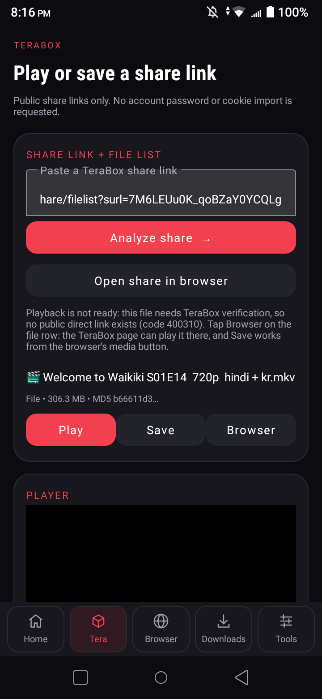
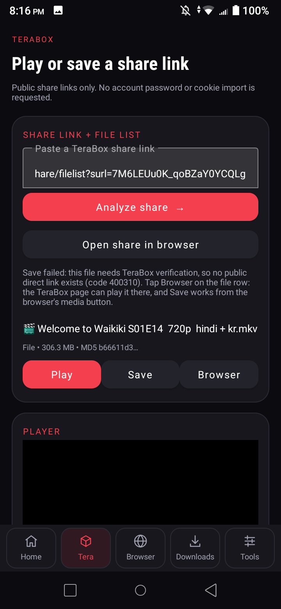

# Why TeraBox Play/Save says "needs verification (400310)" — and what actually fixes it
**1.4.0 / versionCode 14 — evidence recorded 2026-10-13**

## What the two screenshots show

 

The share lists correctly (name, size, MD5 all come from TeraBox itself). **Play** and **Save** then
answer *"TeraBox requires verification (code 400310)."* That is not a StreamDock bug and not a broken
link — it is TeraBox refusing, for this session, to *mint a direct file URL*. Listing a share and
minting a download link are two different permissions.

## The proof (all commands replayable)

A full browser-equivalent session was built with Python + requests: open the share page, keep the
cookies TeraBox sets (`PANWEB`, `TSID`, `browserid`, `csrfToken`, `lang`), read the signature fields
from the mobile share page, then call the API exactly the way `index.ck9924y1.js` (the real web-share
bundle) does.

| Attempt (anonymous, browser-identical session) | Result |
| --- | --- |
| `POST /share/list` (app host `www.terabox.app`) | **errno 0** — files listed, `uk`/`shareid` returned |
| WAP share page `/wap/share/filelist?surl=…` (mobile UA, 124,572 bytes) | carries **`sign`, `timestamp`, `shareid`, `uk`, `jsToken`** — but **no `dlink`**, and the record shows `play_forbid` |
| `/share/tplconfig?fields=sign,timestamp` on 5 origins × 2 channels | endpoint is retired as of today: every host answers **HTML "we can't find…"** |
| `GET /share/download` with the real `sign` + `timestamp` + `jsToken` — `app_id=250528`, `web=1`, `channel=dubox`, `clienttype=0`, `shareid`, `dp-logid`, `nozip=0`, `encrypt=0`, `product=share`, `uk`, `primaryid`, `fid_list=[fs_id]`, `type=nolimit` | **errno 400310, errmsg "need verify_v2"** on **all five** origins: terabox.app, 1024tera.com, terabox.com, 1024terabox.com, teraboxapp.com |
| `GET /share/streaming` (`fid`, `shareid`, `sign`, `timestamp`, `type=M3U8`, `esl=1`, `isplayer=1`, `jsToken`) | `{"errno":31023,"show_msg":"some error happends"}` — no manifest without verification |

`need verify_v2` is TeraBox's CAPTCHA/device-verification gate. It is answered by the server, for every
origin, on a session that already holds the right signature and token — so a correct request is not the
missing piece. **A verified TeraBox session is the missing piece.**

## The open-source survey (2026-10-13)

| Project | License | Verdict |
| --- | --- | --- |
| **Paidguy/terabox-api** (rev `4d3149a22888018375a933d1c0c0ebc3eef32fb6`, 2026-09-21) | MIT | **Used.** The reference implementation. Its own error table maps this exact wall to `verification_required` ("TeraBox is asking for CAPTCHA verification… retry shortly"), and its fix is a server-held, verified `TERABOX_COOKIE` session. Now vendored at `backend/terabox-api/` (see `backend/README-STREAMDOCK.md`). |
| yt-dlp | Unlicense | **No TeraBox extractor exists** (`yt_dlp/extractor/_extractors.py` has no terabox/dubox entry), so the bundled yt-dlp engine cannot resolve these shares. |
| r0ld3x/teraboxdownloader-android, veloredge/vetera, codex67cm/TeraboxDownloader | mixed | Not importable / not Android / no working anonymous path (see earlier reviews). |
| Third-party "terabox downloader" web APIs | — | Rejected by product rule: a user's share link is never silently forwarded to a stranger's service. |

**Conclusion (unchanged, now fully evidenced):** no open-source client mints a direct TeraBox link for a
verification-walled share from an *anonymous* session, because the wall is on TeraBox's side. StreamDock
will not fake it, will not solve a CAPTCHA for the user, and will not copy browser credentials into a
download (`verify_browser_release.py` gates forbid cookie export).

## What code 14 does about it

1. **Browser path (free, no setup)** — every file row has **Browser**, and the link card has **Open share
   in browser**. The share opens in the built-in Chromium browser, where the TeraBox page uses its *own*
   session. Code 14 detects that page's verification step and says so:
   *"TeraBox is showing its own verification step on this page. Complete it here (StreamDock never asks for
   your password), then press Play — the media button can save the stream the page loads."*
   The empty-media dialog is Tera-aware too ("Play it on the TeraBox page" + Reload). Once the page plays,
   the capture button lists the stream and Save stores it **in the in-app engine** — code 13 added a real
   HLS saver that fetches the segments in order, keeps them on pause and refuses DRM honestly.
2. **Resolver path (native Play/Save, one-time setup you own)** — `Advanced → Resolver settings` now
   accepts `name.workers.dev` or a full origin, and `docs/RESOLVER-SETUP.md` + `backend/terabox-api/`
   ship the MIT service with a deploy recipe. A resolver holds *its own* verified TeraBox session, so
   Play and Save work natively and the file list arrives with `stream_url`s. If the resolver itself hits
   the wall, the app now says exactly which code came back (`verification_required`, `cookie_invalid`,
   `password_required`) instead of a generic failure.
3. **Shorter, honest messages** — the 400310 text is now two lines naming both options; nothing claims a
   download that did not happen.

**What no version can promise:** a share that TeraBox has put behind account/captcha verification cannot
be downloaded by an anonymous client, period. That is TeraBox's product decision, not an engine bug.
